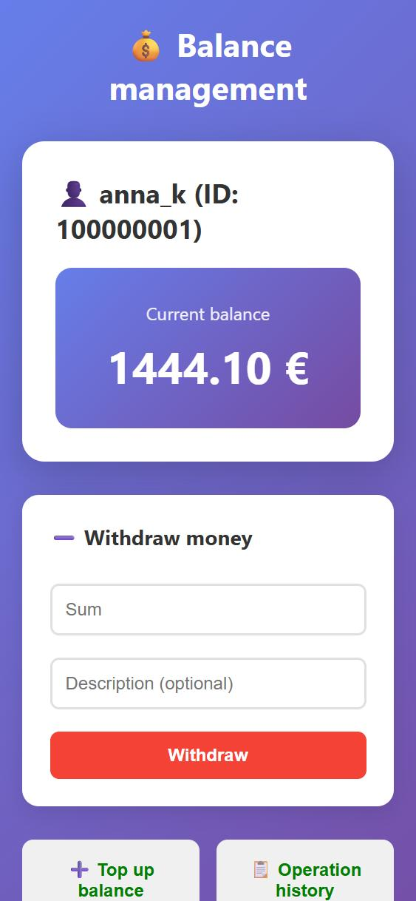
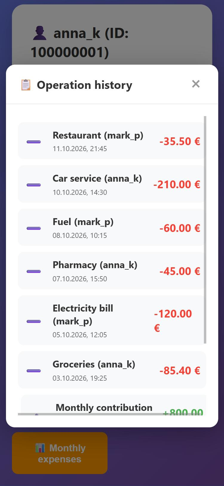
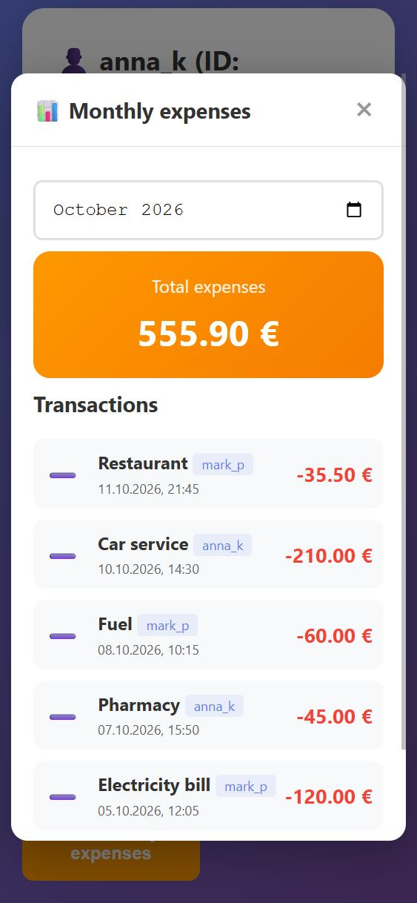

# Shared Balance

[](https://github.com/OlgaAntonikova/shared-balance/actions/workflows/ci.yml)
[](LICENSE)

A Telegram Mini App for keeping one shared balance for a family or a small group. Every member can top up or spend from the common pot, and every operation is recorded with its author and time.

It runs in production and is used by a real family. Members open it from a Telegram bot and are signed in automatically, with no passwords.

<p align="center">
  
  
  
</p>

<p align="center"><sub>Screenshots use demo data.</sub></p>

## Features

- **One shared balance** for all members; a withdrawal can never take it below zero
- **Top-ups and withdrawals** with an optional description
- **Operation history** showing who did what and when
- **Monthly expenses** report with a month picker and total
- **Telegram sign-in**: the Mini App's `initData` is verified on the server, then the API is accessed with a JWT
- **Allow-list of members**: only users present in the database can sign in

## Tech stack

| Layer | Technology |
|---|---|
| Backend | ASP.NET Core 8 (controllers), Entity Framework Core 9 |
| Database | SQLite |
| Auth | Telegram Mini App `initData` (HMAC-SHA256) → JWT bearer tokens |
| Frontend | Vanilla JavaScript, HTML, CSS (no framework), Telegram WebApp SDK |
| Tests | xUnit |
| CI | GitHub Actions |
| Hosting | Linux VPS (DigitalOcean), systemd |

## How sign-in works

1. Telegram opens the Mini App and passes signed `initData` (user id, `auth_date`, `hash`).
2. The frontend sends it to `POST /api/auth/telegram`.
3. The server checks the signature as described in the [Telegram docs](https://core.telegram.org/bots/webapps#validating-data-received-via-the-mini-app): it rebuilds the data-check string, computes `HMAC-SHA256` with a key derived from the bot token, and compares the result in constant time. Data older than 24 hours is rejected.
4. If the Telegram user is on the allow-list, the server issues a JWT, which the frontend sends with every API call.

## API

| Method | Endpoint | Description |
|---|---|---|
| `POST` | `/api/auth/telegram` | Exchange Telegram `initData` for a JWT |
| `GET` | `/api/auth/check` | Check the current token |
| `GET` | `/api/balance` | Current shared balance |
| `GET` | `/api/balance/user` | Current user |
| `POST` | `/api/balance/deposit` | Top up: `{ "Amount": 50, "Description": "..." }` |
| `POST` | `/api/balance/withdraw` | Spend: `{ "Amount": 20, "Description": "..." }` |
| `GET` | `/api/balance/transactions` | Operation history |
| `GET` | `/api/balance/monthly-expenses?year=2026&month=10` | Expenses for a month |

All `/api/balance` endpoints require `Authorization: Bearer <token>`.

## Configuration

Secrets are never stored in the repository. The app refuses to start if they are missing.

| Key | Environment variable | Description |
|---|---|---|
| `Telegram:BotToken` | `Telegram__BotToken` | Bot token from @BotFather (used to verify `initData`) |
| `Jwt:Secret` | `Jwt__Secret` | JWT signing key, at least 32 characters |
| `ConnectionStrings:DefaultConnection` | `ConnectionStrings__DefaultConnection` | SQLite connection string |
| `Seed:Users` | `Seed__Users__0__TelegramId`, `Seed__Users__0__UserName`, ... | Members created when the database is empty |

## Running locally

Requires the [.NET 8 SDK](https://dotnet.microsoft.com/download/dotnet/8.0).

```bash
cd SK_AccountingMoney/SK_AccountingMoney
dotnet user-secrets set "Telegram:BotToken" "<your bot token>"
dotnet user-secrets set "Jwt:Secret" "<random string of 32+ characters>"
dotnet user-secrets set "Seed:Users:0:TelegramId" "<your Telegram user id>"
dotnet user-secrets set "Seed:Users:0:UserName" "<your name>"
dotnet run
```

In the Development environment the database is a local `accounting.db` file. To use the app inside Telegram, expose it over HTTPS (for example with a tunnel) and set that URL as the Mini App URL in @BotFather.

## Tests

```bash
dotnet test SK_AccountingMoney/SK_AccountingMoney.sln
```

The tests cover Telegram `initData` verification (valid signature, wrong bot token, tampered user id, missing or malformed hash, expired data) and UTC handling of stored timestamps.

## Deployment

The production instance runs as a systemd service. Secrets come from an `EnvironmentFile` readable only by root, and the SQLite database lives outside the publish folder, so redeploying never touches the data:

```bash
dotnet publish SK_AccountingMoney/SK_AccountingMoney/SK_AccountingMoney.csproj -c Release -o ./publish
```

## License

[MIT](LICENSE)
